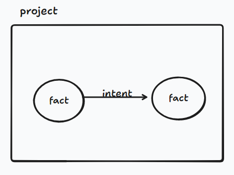

# 数据结构
## 核心业务对象
项目project：
工人worker：子agent，用于实际执行intent。

采用图的方式描述项目的状态：
fact：节点
intent：边

## 对象列字段
项目project：
- id
- name
- status
- facts：存储当前项目所有的事实，项目创建时需要自动创建两个fact，一个start、一个goal，goal用于存储目标任务
- intents：存储当前项目所有的边
- docker：指向一个kali docker容器的name
- hint: 提示
- objective: 目标

fact：
- id：存储该fact在图中的id
- description：存储事实描述

intent：
- id：边的编号
- from：fact的编号
- to：fact的编号
- description：存储实际意图
- status：当前intent是否完成

worker：
- docker_session：一个worker维护一个docker的session用于子agent执行命令

## 对象之间的关系

## 数据类型
主要是id，可以采取纯数字也可以采取字符串，我直接采取数字吧
project.status：采取字符串进行描述，需要描述的几种状态，1.项目可运行active、inactive。2.项目可运行但是停止stoped/运行中running。3.项目已完成completed。状态机:inactive->active->running->stoped->running->completed
intent.status: active->running->completed

# 项目架构图
## 按层拆分
server层:为数据访问提供统一接口，使用sqlite本地存储，dispatcher层通过http协议访问。
dispatcher层：对项目执行进行调度。

## 关键调用关系/流程
1. 拿到一个项目后，先判断这个项目是否可执行(active)
2. 执行该项目，先分析是否为第一次执行，如果是的话进行首次执行逻辑（很多项目都出现第一次和后边的逻辑不同），不是
- 首次执行：创建一个初始intent（不需要描述），尝试直接得到答案，如果没有得到答案则是得到一个fact。初始intent的两端从start指向goal。
- 循环逻辑：先判断是否项目完成(先做这个工作，通过判断facts中是否有flag)，然后判断是否存在未执行的intent，如果存在则进入explore模式开始执行intent。如果不存在未执行的intent则进入reason模式，没有完成的话进行下一步intent规划。

3. 执行intent的实际方式：创建一个kali容器，在容器中直接调用agent(放一个agents.md供codex读取，告知有哪些工具/怎么使用)/llm(手动实现一个工具执行agent，定制工具)。需要注意的是，**一个项目使用一个容器**即可，如果每个worker一个容器的话开销太大了。
- 采用多agent的主要目的是多个intents采用多线程的方式同时执行，提高并发能力。